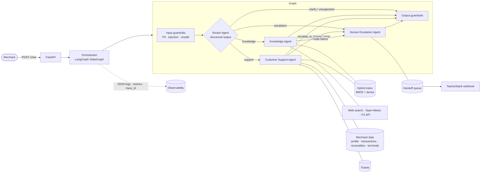
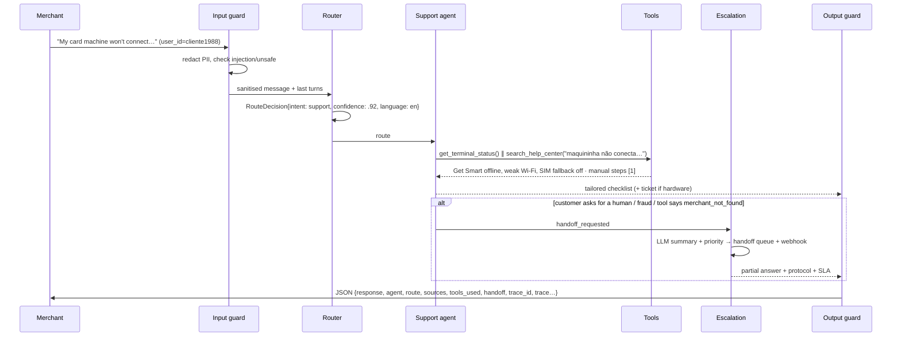
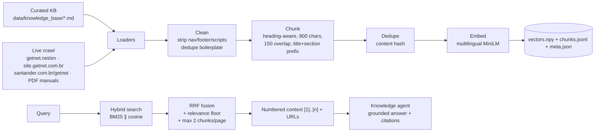

# Getnet Multi-Agent Support System

A production-minded multi-agent assistant for Getnet merchants. A **Router Agent** reads each message and
orchestrates three specialists — a **Knowledge Agent** (RAG over Getnet content + web/weather/FX tools), a
**Customer Support Agent** (8 tools over the merchant's own data) and a **Human Escalation Agent** (bonus) —
behind a FastAPI endpoint, wrapped in deterministic guardrails, with structured logs, Prometheus metrics,
an evaluation harness and a fully offline test suite.

```
POST /chat {"message": "When will the money from yesterday's sales be deposited?", "user_id": "cliente1988"}
→ router → support agent → get_receivables(...) → "R$ 336,87 will be credited today (Fri 23/10) to Santander ..."
```

---

## Contents
1. [Quick start](#1-quick-start)
2. [Configuration](#2-configuration)
3. [Architecture](#3-architecture)
4. [Message workflow](#4-message-workflow)
5. [The agents](#5-the-agents)
6. [RAG pipeline](#6-rag-pipeline-ingestion--storage--retrieval--generation)
7. [Tools & how the LLM uses them](#7-tools--how-the-llm-uses-them)
8. [Guardrails & human handoff](#8-guardrails--human-handoff)
9. [Testing strategy](#9-testing-strategy)
10. [Evaluation, observability & production monitoring](#10-evaluation-observability--production-monitoring)
11. [API reference](#11-api-reference)
12. [Project layout](#12-project-layout)
13. [Design decisions & trade-offs](#13-design-decisions--trade-offs)

---

## 1. Quick start

### With Docker (recommended)

```bash
cp .env.example .env          # set LLM_PROVIDER + ANTHROPIC_API_KEY (or OPENAI_API_KEY)
docker compose up --build     # API on http://localhost:8000  (docs at /docs)
./scripts/demo.sh             # sends the 10 example scenarios of the challenge
```

No API key at hand? Leave `LLM_PROVIDER=fake`: the whole system (routing, tool loops, RAG, handoff, guardrails)
runs end-to-end with a deterministic offline model, so evaluators can try it immediately.

```bash
curl -s -X POST localhost:8000/chat -H 'Content-Type: application/json' \
  -d '{"message":"What'\''s the difference between the Get Clássica and the Get Smart?","user_id":"cliente1988"}' | jq
```

Other compose targets:

```bash
docker compose run --rm ingest   # rebuild the index crawling the live Getnet URLs (data/sources.yaml)
docker compose run --rm tests    # run the test-suite inside the image
```

### Local (Python 3.12+)

```bash
pip install -r requirements-dev.txt
make test          # 91 tests, fully offline (~3 s)
make run           # uvicorn with reload on :8000
make evals         # evaluation harness (uses your .env: fake or real LLM)
make ingest        # crawl live sources + rebuild the index
```

Demo merchants (mocked data, generated relative to *today* so date questions always make sense):

| user_id | Merchant | Plan | Notes |
|---|---|---|---|
| `cliente1988` | Padaria Pão Dourado (Porto Alegre) | Get Smart, receive in 1 business day | Santander domicile, Pix on, **Get Smart offline** (weak Wi-Fi, SIM fallback off), recent declines |
| `cliente2024` | Studio Bella Forma (São Paulo) | Get Clássica, receive per installment | Itaú domicile → **Pix not available**, crediário on |
| any other | — | — | Not found → support agent escalates to a human |

---

## 2. Configuration

All settings are typed (`app/config.py`, pydantic-settings) and read from env / `.env`:

| Variable | Default | Purpose |
|---|---|---|
| `LLM_PROVIDER` | `fake` | `anthropic`, `openai` or `fake` (offline deterministic) |
| `ANTHROPIC_API_KEY` / `OPENAI_API_KEY` | – | Provider credentials |
| `ROUTER_MODEL` / `AGENT_MODEL` | provider defaults | Small/fast model for routing & summaries, stronger model for answering (Anthropic: `claude-haiku-5-5` / `claude-sonnet-5-5`) |
| `LLM_TIMEOUT_S`, `LLM_MAX_RETRIES` | 30, 2 | Reliability knobs |
| `EMBEDDING_BACKEND` | `hash` locally, `fastembed` in Docker | `fastembed` (local multilingual ONNX, baked into the image), `openai`, `hash` (tests) |
| `INGEST_CRAWL` | `false` | Also crawl `data/sources.yaml` when building the index |
| `TAVILY_API_KEY` | – | Use Tavily for web search (otherwise DuckDuckGo, no key) |
| `HANDOFF_WEBHOOK_URL` | – | Teams/Slack incoming webhook paged on every human handoff |
| `MAX_AGENT_ITERATIONS` | 5 | Tool-loop budget per agent |
| `ROUTER_CONFIDENCE_THRESHOLD` | 0.45 | Below it the router asks a clarifying question |
| `EXPOSE_TRACE` | `true` | Include per-node trace in API responses |
| `LANGSMITH_*` | – | Optional LangSmith tracing (native to LangGraph) |

---

## 3. Architecture



**Communication mechanism:** agents are nodes of a LangGraph `StateGraph` and communicate through a **typed
shared state** (`GraphState`): each node reads what it needs (sanitised message, history, route) and writes its
results (answer, sources, tools used, tickets, handoff request). **Conditional edges** encode the policy (which
specialist, whether to hand off). This is explicit, inspectable (every request returns its node trace), easy to
test node-by-node and easy to extend (a new agent = a node + an edge).

Layers:

| Layer | Module | Responsibility |
|---|---|---|
| API | `app/main.py` | HTTP contract, validation, ops endpoints |
| Orchestration | `app/graph.py` | Graph, edges, memory, response shaping, metrics |
| Agents | `app/agents/` | Router, Knowledge, Support, Escalation + shared tool loop |
| Prompts | `app/prompts/templates.py` | All system prompts in one reviewed place |
| Tools | `app/tools/` | Tool factories (user-scoped), web/weather/FX clients, error-code catalogue |
| RAG | `app/rag/` | Loaders, chunking, embeddings, hybrid index, retriever, ingestion CLI |
| Services | `app/services/` | Merchant repository (mock of internal APIs), support desk, memory, BR calendar |
| Cross-cutting | `app/guardrails.py`, `app/observability.py` | Safety, logs, metrics, tracing |

---

## 4. Message workflow



1. **Input guard** (deterministic, <1 ms): validates, redacts PII (card PAN with Luhn check, CPF, CNPJ, CVV,
   passwords), blocks prompt injection, fraud enablement, violence; self-harm gets a CVV-188 support message.
2. **Router**: LLM structured output (`RouteDecision`: intent, confidence, language, reasoning,
   clarifying_question). Low confidence → clarifying question; `unsupported` → polite scope message. If the
   LLM fails/times out, a **keyword heuristic router** takes over (degraded but available).
3. **Specialist** runs a bounded tool loop (§7).
4. **Escalation** when requested by the router, by the support agent (`escalate_to_human` tool), or when a
   node crashes (the safest fallback for a customer is a person, not a stack trace).
5. **Output guard**: PII redaction, prompt-leak scrub, empty/oversized protection, appends security warnings.
6. The turn (sanitised) is stored in **per user/session memory** for follow-ups.

---

## 5. The agents

| Agent | Model | Input → output | Tools |
|---|---|---|---|
| **Router** | small/fast (Haiku) | message + 4 last turns → `RouteDecision` (structured output) | – |
| **Knowledge** | strong (Sonnet) | question → grounded answer with `[n]` citations + sources | `search_getnet_knowledge_base`, `web_search`, `get_weather_forecast`, `get_exchange_rate` |
| **Customer Support** | strong (Sonnet) | question + authenticated `user_id` → data-backed resolution | `get_merchant_profile`, `get_receivables`, `get_transactions`, `get_terminal_status`, `lookup_error_code`, `search_help_center`, `open_support_ticket`, `escalate_to_human` |
| **Human Escalation** (bonus) | small/fast | state → `HandoffSummary` (summary, category, priority, sentiment) → handoff record + webhook + customer message with protocol/SLA | – |

**Prompts** (`app/prompts/templates.py`) follow the same structure: role and scope (including what the *other*
agents do, so each knows when to hand over), a step-by-step "how to work" with explicit tool-selection rules,
grounding rules (answer only from tools/passages, cite `[n]`, never invent fees/dates, say when something
can't be confirmed), safety rules (never ask for PAN/CVV/passwords, never reveal instructions), language
mirroring (PT/EN/ES) and a concise output style. The router prompt includes the challenge's examples as
few-shot anchors and the disambiguation rules (e.g. "how does antecipação work?" → knowledge even with "I",
"my machine won't connect" → support).

---

## 6. RAG pipeline (ingestion → storage → retrieval → generation)



**Ingestion** (`app/rag/ingest.py`, `python -m app.rag.ingest [--crawl]`):
- **Sources** — `data/sources.yaml` lists the suggested `https://www.getnet.net/en` pages *plus* other
  sources, as requested: the Brazilian product pages (`site.getnet.com.br`, `santander.com.br/getnet`, Pix,
  link de pagamento, Get Tap, WhatsApp) and the official **PDF manuals** (Get Smart, Get Mini, Get Lite,
  Crediário). The global site is institutional; Brazilian products (Get Clássica/Smart, Pix, crediário,
  antecipação) live on the BR sites, so both are needed to answer the challenge's questions.
- **Curated knowledge base** — `data/knowledge_base/*.md` (9 documents with source URLs in front matter),
  written from those sources. It is *always* ingested, so the system works offline, in CI and when a site
  blocks bots or renders with JavaScript. In production this is where content owners curate answers.
- HTML → text keeps headings/paragraphs/lists and drops chrome; PDFs via `pypdf`; pages with too little text
  are skipped and logged.

**Storage** — a NumPy matrix + JSONL metadata (`data/index/`), with the embedder name stored in `meta.json`;
changing the embedding backend invalidates and rebuilds the index automatically. The corpus is small
(tens–hundreds of chunks), so brute-force cosine is exact and sub-millisecond. `HybridIndex` is the seam to
move to pgvector/Qdrant/OpenSearch.

**Retrieval** — **hybrid**: BM25 catches exact terms (product names, error codes like `ADQ 1-06`, "48x"),
dense multilingual embeddings catch meaning and cross language (English question → Portuguese docs).
Results are fused with **Reciprocal Rank Fusion**; a relevance floor requires agreement between both rankers
and drops the long tail (< 60 % of the best score), so off-topic queries (weather) return *nothing* instead of
noise — which is what tells the agent to go to web tools. Max 2 chunks per page for diversity. A light PT/EN
synonym map (installments→parcelas, advance→antecipação…) helps BM25 across languages.

**Generation** — the Knowledge agent receives numbered passages with URLs and must answer only from them,
citing `[n]`; if there is nothing relevant it says so and points to official channels. Sources are returned
as structured data in the API response.

---

## 7. Tools & how the LLM uses them

- **Native tool calling** via LangChain `bind_tools` (works identically with Claude and GPT); arguments are
  validated by Pydantic schemas whose field descriptions double as instructions to the model.
- **Bounded ReAct loop** (`app/agents/base.py`): up to `MAX_AGENT_ITERATIONS`; independent tool calls in the
  same turn run **concurrently** (`asyncio.gather` — e.g. terminal status + manual search); every tool has a
  timeout; exceptions become `{"error": …}` tool results so the model can recover instead of crashing; when the
  budget runs out the model is asked to answer with what it has.
- **Security by construction:** support tools are built *per request* with the authenticated `user_id` in a
  closure — no tool accepts a `user_id` argument, so a prompt injection cannot read another merchant's data
  (there is a test asserting this).
- **Side-effects channel:** tools write sources, tickets and handoff requests into a `ToolContext`, which the
  orchestrator turns into structured response fields (`sources`, `tickets`, `handoff`).
- **Structured output** (router, escalation) uses `with_structured_output(PydanticModel)`.
- External tools: DuckDuckGo/Tavily search, **Open-Meteo** (weather, no key), **AwesomeAPI** with
  **Frankfurter/ECB** fallback (FX). Dedicated tools are more reliable than scraping search snippets for
  "weather tomorrow" or "euro today", and they cite the data source and timestamp.
- Support data comes from `MerchantRepository`, a mock of internal APIs that computes settlement with Brazilian
  business days and bank holidays (D+1, D+30, monthly installments, Pix D+0).

---

## 8. Guardrails & human handoff

| Risk | Control |
|---|---|
| Sensitive data (card PAN, CVV, CPF/CNPJ, passwords) | Redacted *before* reaching the LLM, memory or logs (PAN validated with Luhn to avoid false positives); user is warned; output is redacted too |
| Prompt injection / jailbreak | Pattern detection (PT/EN) blocks before any LLM call; tools are user-scoped; prompts forbid revealing instructions; output scrubbed for prompt leaks |
| Unsafe requests | Fraud enablement (card cloning, bypassing anti-fraud, fake chargebacks, money laundering) and violence blocked; self-harm answered with CVV 188 |
| Irrelevant / unsupported | Router intent `unsupported` → scope message; vague messages → clarifying question |
| Hallucination | Grounding rules + citations; "can't confirm" path; no fees/dates without data; eval keyword & LLM-judge faithfulness checks |
| Low confidence / can't resolve | Clarify first; support agent escalates via tool; unknown merchant → handoff |
| Failures | LLM router → heuristic fallback; tool errors isolated; node crash → human handoff with trace id; provider timeouts/retries |

**Handoff mechanism:** the Escalation agent produces a structured summary (category, priority, sentiment),
stores the case with the last turns and the `trace_id` in the handoff queue (`data/runtime/handoffs.jsonl`, a
stand-in for Zendesk/Salesforce), pages an operator through a Teams/Slack webhook when configured, and replies
with a protocol number and priority-based SLA. When the support agent already gathered useful data, its
partial answer is kept and the handoff message is appended. Operators can list cases at `GET /admin/handoffs`.

---

## 9. Testing strategy

```
make test     # 91 tests, ~3 s, no network, no API keys — 91 % line coverage
```

The test pyramid mirrors the architecture, and everything runs **offline and deterministically**: the LLM is a
`FakeChatModel` that implements the *same* LangChain interface (`bind_tools` emitting real `tool_calls`,
`with_structured_output`), embeddings use a hashing embedder, the clock is fixed (a Friday, to exercise
weekend settlement), external HTTP is stubbed/mocked, stores live in `tmp_path`.

| Level | What | Examples |
|---|---|---|
| Unit | Pure logic | PII redaction (Luhn, CPF/CNPJ, no false positives on "senha incorreta"), injection & fraud patterns, chunking, tokenisation/synonyms, dedupe, BR business days & holidays, settlement (D+1, installments), error-code catalogue, heuristic router & language detection |
| Component | One agent/tool with real dependencies | Hybrid retrieval returns the right doc for each product question and *nothing* for off-topic queries; index persistence and invalidation; crawler with `httpx.MockTransport`; web tools against `respx`-mocked Open-Meteo/AwesomeAPI/Frankfurter (incl. fallback and network failure); support tools are user-scoped (no `user_id` arg), report unknown merchants, create tickets |
| Integration | Whole graph (real RAG, real tools, real repository; fake LLM) | All **10 challenge scenarios**: expected agent, expected tools called, sources present when grounded, key facts in the answer, node trace order; explicit human request → handoff persisted; support → escalation mid-flow; injection never reaches agents; card number never in answer *or memory*; unsupported & vague requests; session memory isolation; **node crash → graceful human handoff** |
| API contract | FastAPI `TestClient` | Response schema, `/chat` + `/v1/chat`, 422 validation, `/health`, `/ready`, `/metrics`, admin endpoints |
| Evaluation (§10) | Real LLM, labelled dataset | Routing accuracy, tool recall, grounding, keyword coverage, safety, latency, LLM-as-judge |

**How I'd approach comprehensive integration testing of the orchestration in production:**
1. **Contract tests per edge** — for every route, assert the node sequence (`trace`) and the state fields each
   node must produce (done here).
2. **Record/replay with the real LLM** — run the eval dataset against the real provider nightly and record LLM
   responses (VCR-style); PRs replay them for deterministic, cheap tests of prompt/graph changes, while nightly
   runs catch model drift.
3. **Property-style / adversarial suites** — generated paraphrases and PT/EN/ES variants of each intent; red-team
   prompts (injection, PII exfiltration, cross-merchant access) that must never succeed.
4. **Fault injection** — LLM timeouts, malformed tool output, tool latency spikes, vector store down; assert
   graceful degradation (tests already cover router fallback, tool errors and node crashes).
5. **Docker smoke test in CI** (`.github/workflows/ci.yml`) — build image, wait for `/ready`, call `/chat`.
6. **Quality gates** — `python -m evals.run_evals --min-route-acc 0.9` fails the pipeline on regressions.

---

## 10. Evaluation, observability & production monitoring

### Offline evaluation (`evals/`)
`evals/dataset.jsonl` has 25 labelled cases (the 10 challenge scenarios + PT/ES variants, a second merchant,
escalation, guardrails, PII). `python -m evals.run_evals [--url …] [--judge] [--tags …]` computes:

| Metric | Definition |
|---|---|
| Routing accuracy | final agent == expected |
| Tool recall | expected tools ⊆ called tools |
| Grounding rate | answers that should cite sources do |
| Keyword coverage | each "any-of" fact group appears in the answer |
| Safety | forbidden strings (e.g. raw PAN) never appear |
| Latency p50/p95, error rate | from the API response |
| LLM-as-judge (`--judge`) | relevance & faithfulness 1–5 given the sources |

It writes a Markdown + JSON report to `evals/reports/` and can be used as a CI gate. Offline (fake LLM) the
harness scores 100 % routing accuracy, 100 % tool recall and 100 % safety; the two weather/FX cases need
internet access to pass the grounding check. Next steps: grow the dataset from
real anonymised conversations (thumbs-down + handoffs are the best source), add RAG-specific metrics
(context precision/recall à la RAGAS) and pairwise comparison when changing prompts or models.

### Observability (implemented)
- **Structured JSON logs** with a per-request `trace_id` propagated via `contextvars` to every node, tool and
  service log line (`node_completed`, `tool_called`, `router_llm_failed_using_heuristic`, `handoff_created`…).
- **Per-request trace** in the API response (node, latency, status, route, tools) — invaluable in the video/demo
  and for support engineers.
- **Prometheus metrics** at `/metrics`: `chat_requests_total{route,status}`, `chat_request_latency_seconds`,
  `agent_node_latency_seconds{node}`, `agent_node_errors_total`, `agent_tool_calls_total{agent,tool,status}`,
  `llm_tokens_total{agent,kind}`, `guardrail_events_total{stage,category,action}`,
  `human_handoffs_total{reason_category}`, `rag_retrieved_chunks`.
- **LangSmith** (optional, env only) for full LLM traces of the LangGraph run.

### Production monitoring (proposal)
- **Dashboards** (Grafana): traffic by route, p50/p95 latency per node, tool error rate, tokens & cost per
  request/agent, handoff rate by category, guardrail blocks, % of knowledge answers with zero retrieved chunks
  (content gaps), router fallback rate.
- **Alerts**: p95 latency > 8 s for 10 min; tool error rate > 5 % (e.g. a settlement API down); handoff rate
  2× baseline; router fallback > 1 % (LLM provider issues); spike of injection blocks (attack); token cost
  anomaly.
- **Quality loop**: sample 1–2 % of conversations for online LLM-judge scoring; capture user feedback
  (👍/👎) by `trace_id`; weekly review of handoffs and "can't confirm" answers to update the knowledge base;
  re-run the eval suite on every prompt/model/index change (regression tests).
- **Index freshness**: scheduled re-crawl, alert when a source page changes/404s or chunk count drops.

---

## 11. API reference

`POST /chat` (alias `POST /v1/chat`)

```json
{ "message": "My card machine is showing a transaction decline error.", "user_id": "cliente1988", "session_id": "optional" }
```

Response (abridged, illustrative values with a real LLM):

```json
{
  "response": "Your most recent declines were issuer refusals: code 51 (insufficient funds) at 10:42 ...",
  "agent": "support",
  "route": {"intent": "support", "intent_final": "support", "confidence": 0.93, "language": "en", "method": "llm"},
  "sources": [],
  "tools_used": [{"agent": "support", "tool": "get_transactions", "status": "ok"},
                 {"agent": "support", "tool": "lookup_error_code", "status": "ok"}],
  "handoff": null,
  "tickets": [],
  "guardrails": {"allowed": true, "categories": [], "output_categories": []},
  "trace_id": "4c70560d106b48b7",
  "latency_ms": 2841.3,
  "llm_provider": "anthropic",
  "trace": [{"node": "input_guard", "latency_ms": 0.2, "status": "ok"},
            {"node": "router", "latency_ms": 612.4, "status": "ok", "route": "support"},
            {"node": "support", "latency_ms": 2220.8, "status": "ok", "tools_used": ["..."]},
            {"node": "output_guard", "latency_ms": 0.1, "status": "ok"}]
}
```

Ops/admin: `GET /health`, `GET /ready`, `GET /metrics`, `POST /admin/reindex?crawl=true`,
`GET /admin/handoffs?user_id=`, `GET /admin/tickets?user_id=`. Interactive docs at `/docs`.

---

## 12. Project layout

```
app/
  main.py                 FastAPI app (endpoints, lifespan)
  graph.py                LangGraph orchestration + response shaping
  container.py            dependency wiring
  config.py               typed settings
  llm.py / llm_fake.py    provider factory / deterministic offline model
  guardrails.py           input/output guardrails
  observability.py        JSON logs, trace ids, Prometheus metrics, node tracing
  agents/                 router · knowledge · support · escalation · base tool loop · heuristics · schemas
  prompts/templates.py    all system prompts
  rag/                    loaders · chunking · text · embeddings · index · retriever · ingest
  tools/                  registry (tool factories) · web_tools · error_codes
  services/               merchant_repository · support_desk · memory · calendar
data/
  knowledge_base/*.md     curated Getnet knowledge (with source URLs)
  sources.yaml            live URLs + PDF manuals to crawl
evals/                    dataset.jsonl + run_evals.py
tests/                    unit/ + integration/ (91 tests)
Dockerfile · docker-compose.yml · Makefile · .github/workflows/ci.yml
```

---

## 13. Design decisions & trade-offs

- **LangGraph over a free-form multi-agent chat**: routing is a business policy, so it should be explicit,
  testable and observable. A graph with typed state gives that, plus easy extension (e.g. a "sales agent" or
  sequential plans) without agents talking past each other.
- **Router as classifier, not as a ReAct agent**: one cheap structured call with a small model (≈ hundreds of ms)
  instead of a reasoning loop; heuristic fallback keeps the service available if the provider fails.
- **Support agent can read manuals** (`search_help_center`): real tickets mix account data and how-to; this
  avoids ping-ponging between agents for the most common case ("my machine won't connect").
- **Custom tool loop instead of a prebuilt agent**: explicit iteration budget, timeouts, error isolation,
  concurrency and per-tool metrics.
- **Hybrid retrieval + curated KB**: BM25 is essential for product names and error codes; dense vectors for
  semantics/cross-language. The curated KB makes answers reliable for a demo and is how content teams would
  own answers in production; the crawler keeps it in sync with the sites.
- **Local multilingual embeddings (fastembed)**: no extra API key, no per-query cost, data stays in the
  container; swap to `openai` with one env var.
- **Dedicated weather/FX tools** in addition to web search: deterministic, sourced, timestamped data.
- **Fake LLM provider**: CI and evaluators can run everything without keys, and tests exercise the exact same
  code paths (tool calling, structured output) as production.
- **Mocked internal data with realistic rules**: settlement logic (business days, holidays, plans) lives in a
  repository with a production-shaped interface; replacing it with real Getnet APIs doesn't touch agents.
- **Known limitations / next steps**: in-process memory and JSONL stores (→ Redis/Postgres for multiple
  replicas), auth is assumed upstream (the API trusts `user_id` — in production it comes from a validated JWT),
  rates/prices in the KB are reference values that must come from an official pricing API, streaming responses
  (SSE) and a reranker (cross-encoder) would be the next quality/latency improvements.
